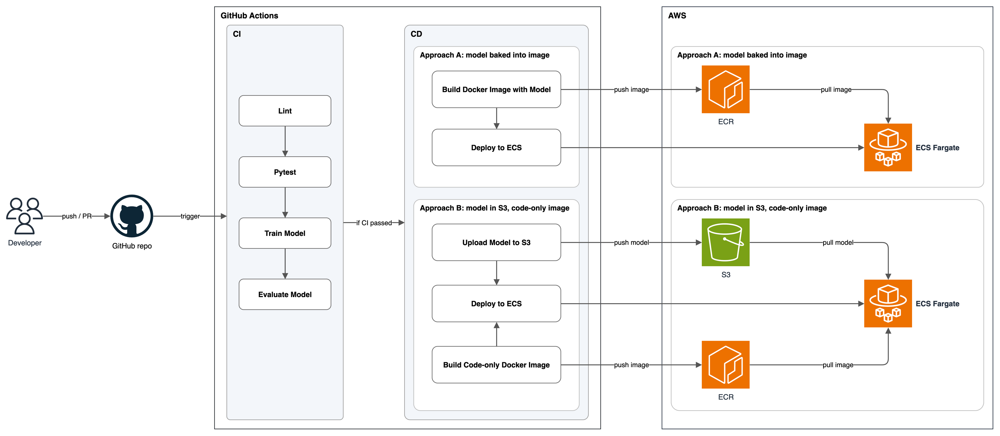

# Iris MLOps

A small MLOps pipeline: train a logistic regression on the Iris dataset, block it if accuracy is too low, package it as a Docker image in two different ways, and deploy both to Amazon ECS (Fargate) with GitHub Actions.

## Architecture



Editable source: [architecture.drawio](architecture.drawio)

- **CI** runs on every push to `main` and every pull request: lint, tests, train, evaluate.
- **CD** runs only after CI passes on `main`, once per approach. Each approach has its own ECS service in one cluster.

## Two ways to ship the model

### Approach A: model baked into the image

CD copies `model.joblib` into the Docker image (`docker/Dockerfile.model-in-image`) and pushes it to ECR as `<sha>-bake`.
The container has the model as soon as it starts and needs no AWS access at runtime. Rolling back means running an older image.

**Limitation:** model and code share one lifecycle. Every retrain builds, pushes and deploys a whole new image (about 800 MB here), even when no code changed. With frequent retraining or a large model, releases get slow and the registry keeps growing.

### Approach B: model in S3, code-only image

CD uploads the model to S3 (`iris/<sha>/` and `iris/latest/`). The image (`docker/Dockerfile.code-only-image`) contains only the API code (`src/api/`) and is rebuilt only when that code changes. At startup the container downloads the model from `MODEL_URI`.

A new model is just a few KB uploaded to S3 plus a restart. The cost: the container needs read access to S3, and it loads the model before it can serve requests.

|  | A: model in image | B: model in S3 |
|---|---|---|
| New model | Build, push and deploy an image | Upload the model, restart |
| Code change | New image | New image |
| Container startup | Model ready | Downloads the model first |
| AWS access at runtime | None | S3 read |
| Roll back a model | Run an older image | Point `MODEL_URI` to `iris/<sha>/` |

## Repository layout

```
src/model/             train.py, evaluate.py, gate.py (exit 1 if accuracy is below the threshold)
src/api/               FastAPI app (/health, /predict) and model loader (local or S3)
tests/                 data, model and API tests
docker/                Dockerfile.model-in-image (A), Dockerfile.code-only-image (B), local S3 init script
infra/template.yaml    CloudFormation: S3 bucket, ECR repository, ECS Fargate, IAM (GitHub OIDC)
.github/workflows/     ci.yml, cd-model-in-image.yml, cd-code-only-image.yml
config.yaml            hyperparameters and accuracy threshold
docker-compose.yml     run both approaches locally, with S3 emulated by Moto
```

| Workflow | Runs when | Does |
|---|---|---|
| `ci.yml` | Push to `main`, pull request | Lint → pytest (data) → train → evaluate + gate → pytest (model, API) → keep the model as an artifact |
| `cd-model-in-image.yml` | CI passed on `main` | If API or model code changed: build image with model → smoke test → push `<sha>-bake` → deploy to ECS |
| `cd-code-only-image.yml` | CI passed on `main` | If model code changed: upload model to S3. If API code changed: build code-only image → smoke test → push `<sha>-s3`. After either one: deploy to ECS (the new image, or a restart to load the new model) |

CD decides what to ship from the changed paths, compared with the commit of the last image in ECR or of the model in S3 (kept as `git-sha` object metadata):

| Ships | When these paths changed |
|---|---|
| Model to S3 (B) | `src/model/`, `config.yaml`, `requirements.txt` |
| Code-only image (B) | `src/api/`, `docker/Dockerfile.code-only-image`, `requirements.txt` |
| Image with model (A) | `src/api/`, `src/model/`, `config.yaml`, `requirements.txt`, `docker/Dockerfile.model-in-image` |

Changes to tests or docs only ship nothing.

## Setup

**Prerequisites:** an AWS account with an IAM user (not root) that can sign in to the console and create IAM, S3, ECR, ECS and EC2 security group resources, and a GitHub repository for this code (public repositories get free Actions minutes).

### 0. Install the tools

| Tool | Used for |
|---|---|
| Docker | Running both approaches locally |
| AWS CLI v2, with the `aws login` command | Creating, calling and deleting the AWS resources |
| GitHub CLI (`gh`) | Reading the OIDC subject and setting the repository variable |
| Git | Pushing to GitHub |

macOS, with Homebrew:

```bash
brew install awscli gh git
brew install --cask docker-desktop   # then open Docker Desktop once to start the engine
```

Linux: install the AWS CLI with the official installer, then follow the official guides for [Docker Engine](https://docs.docker.com/engine/install/) and the [GitHub CLI](https://github.com/cli/cli/blob/trunk/docs/install_linux.md):

```bash
curl -s "https://awscli.amazonaws.com/awscli-exe-linux-$(uname -m).zip" -o awscliv2.zip
unzip -q awscliv2.zip && sudo ./aws/install   # add --update to upgrade an existing install
```

Windows: the commands in this README are bash, so use WSL 2 and follow the Linux steps inside it. Docker Desktop for Windows works with WSL 2.

Check the tools and sign in to GitHub:

```bash
docker --version
aws --version
aws login help > /dev/null && echo "aws login: available"   # if not, upgrade the AWS CLI
gh --version
gh auth login
```

### 1. Run locally

Both approaches run in Docker. [Moto](https://github.com/getmoto/moto) stands in for S3, so no AWS account is needed yet.

1. Run the same checks as CI (lint, tests, train, evaluate, gate). This writes `artifacts/model.joblib`, which both approaches need:

   ```bash
   docker compose run --rm ci
   ```

2. Start both APIs. `s3-init` (`docker/s3-init.sh`) creates a bucket in the local S3 and uploads the model, then the Approach B container loads it from there:

   ```bash
   docker compose up --build
   ```

3. Call them:

   ```bash
   curl localhost:8000/health   # Approach A: "model_source": "local"
   curl localhost:8001/health   # Approach B: "model_source": "s3"
   curl -X POST localhost:8000/predict -H 'Content-Type: application/json' \
     -d '{"sepal_length":5.1,"sepal_width":3.5,"petal_length":1.4,"petal_width":0.2}'
   curl -X POST localhost:8001/predict -H 'Content-Type: application/json' \
     -d '{"sepal_length":5.1,"sepal_width":3.5,"petal_length":1.4,"petal_width":0.2}'
   ```

### 2. Create the AWS resources

Sign in first. `aws login` opens the browser for a console sign-in and gives the CLI temporary credentials that it refreshes on its own:

```bash
aws login --region ap-southeast-1
aws sts get-caller-identity   # check the account and user you are signed in as
```

If your `default` profile already belongs to another account, sign in to a separate profile instead, and use it for every command below:

```bash
aws login --profile iris --region ap-southeast-1
export AWS_PROFILE=iris
```

Then create the stack:

```bash
export AWS_REGION=ap-southeast-1

# The default VPC and its subnets are enough: each task gets a public IP.
VPC_ID=$(aws ec2 describe-vpcs --filters Name=is-default,Values=true --query 'Vpcs[0].VpcId' --output text)
SUBNET_IDS=$(aws ec2 describe-subnets --filters Name=vpc-id,Values="$VPC_ID" \
  --query 'Subnets[].SubnetId' --output text | tr '\t' ',')

# The OIDC subject GitHub sends for this repository. New repositories include
# owner and repository IDs in it (repo:owner@123/name@456), so read it from GitHub.
SUB_PREFIX=$(gh api repos/<owner>/<repo>/actions/oidc/customization/sub --jq .sub_claim_prefix)

aws cloudformation deploy \
  --stack-name iris-mlops \
  --template-file infra/template.yaml \
  --capabilities CAPABILITY_NAMED_IAM \
  --parameter-overrides GitHubSubjectPrefix="$SUB_PREFIX" VpcId="$VPC_ID" SubnetIds="$SUBNET_IDS"

aws cloudformation describe-stacks --stack-name iris-mlops \
  --query 'Stacks[0].Outputs' --output table
```

This creates:

- the model bucket `iris-mlops-models-<account-id>` and the ECR repository `iris-api`
- the ECS cluster `iris-mlops` with two services, `iris-model-in-image` (A) and `iris-code-only-image` (B). They start with no running task; the first CD run deploys an image and starts one task each.
- the GitHub OIDC provider and the CI role `iris-ci` (trusted only for `main` of your repository)

If your account already has a GitHub OIDC provider, add `CreateOidcProvider=false` to `--parameter-overrides`.

### 3. Configure GitHub

The workflows sign in to AWS with OIDC, so GitHub stores no AWS secrets. They only need to know which role to assume. Save the CI role ARN as a repository variable:

```bash
gh variable set AWS_ROLE_ARN --repo <owner>/<repo> --body "$(aws cloudformation describe-stacks \
  --stack-name iris-mlops --query "Stacks[0].Outputs[?OutputKey=='CiRoleArn'].OutputValue" --output text)"
```

Nothing else is needed: the workflows derive the bucket name from the account ID.

### 4. Push to `main`

```bash
git push origin main
```

CI runs first. When it passes, both CD workflows ship what changed and deploy it. The first run ships and deploys everything.

### 5. Call the API

Each service runs one task with a public IP. The IP changes on every deploy, so look it up:

```bash
task_ip() {
  TASK=$(aws ecs list-tasks --cluster iris-mlops --service-name "$1" --query 'taskArns[0]' --output text)
  ENI=$(aws ecs describe-tasks --cluster iris-mlops --tasks "$TASK" \
    --query "tasks[0].attachments[0].details[?name=='networkInterfaceId'].value" --output text)
  aws ec2 describe-network-interfaces --network-interface-ids "$ENI" \
    --query 'NetworkInterfaces[0].Association.PublicIp' --output text
}

A=$(task_ip iris-model-in-image)
B=$(task_ip iris-code-only-image)

curl "http://$A:8000/health"   # Approach A: "model_source": "local"
curl "http://$B:8000/health"   # Approach B: "model_source": "s3"
curl -X POST "http://$A:8000/predict" -H 'Content-Type: application/json' \
  -d '{"sepal_length":5.1,"sepal_width":3.5,"petal_length":1.4,"petal_width":0.2}'
curl -X POST "http://$B:8000/predict" -H 'Content-Type: application/json' \
  -d '{"sepal_length":5.1,"sepal_width":3.5,"petal_length":1.4,"petal_width":0.2}'
```

`/health` returns the git SHA and the model source, so you can tell which image and model each service runs.

Two tasks running all the time cost roughly 30 USD a month (Fargate plus public IPv4). To pause a service, scale it to zero; the next deploy scales it back to one:

```bash
aws ecs update-service --cluster iris-mlops --service iris-model-in-image --desired-count 0
```

## Clean up: delete everything

`aws cloudformation delete-stack` alone is not enough, for two reasons:

- CloudFormation won't delete an S3 bucket that still has objects. ECR has an `EmptyOnDelete` option (used in the template), S3 has none.
- The task definition revisions CD registered are not part of the stack.

So run these in order:

```bash
export AWS_REGION=ap-southeast-1
BUCKET=iris-mlops-models-$(aws sts get-caller-identity --query Account --output text)

# 1. Empty the model bucket. It is versioned, so delete every object version and
#    delete marker (one call handles up to 1000, far more than this project creates).
aws s3api delete-objects --bucket "$BUCKET" --delete "$(aws s3api list-object-versions --bucket "$BUCKET" \
  --query '{Objects: [Versions, DeleteMarkers][].{Key: Key, VersionId: VersionId}}' --output json)"

# 2. Delete the stack: ECS cluster and services, ECR repository and its images,
#    bucket, IAM roles and policy, OIDC provider, security group, log group.
aws cloudformation delete-stack --stack-name iris-mlops
aws cloudformation wait stack-delete-complete --stack-name iris-mlops

# 3. Deregister the task definition revisions CD registered (free, but left behind).
for FAMILY in iris-model-in-image iris-code-only-image; do
  for TD in $(aws ecs list-task-definitions --family-prefix "$FAMILY" \
      --query 'taskDefinitionArns[]' --output text); do
    aws ecs deregister-task-definition --task-definition "$TD" > /dev/null
  done
done
```

If step 2 fails, see which resource blocked it:

```bash
aws cloudformation describe-stack-events --stack-name iris-mlops \
  --query "StackEvents[?ResourceStatus=='DELETE_FAILED'].[LogicalResourceId,ResourceStatusReason]" \
  --output table
```

Outside AWS:

1. Delete the GitHub variable (`gh variable delete AWS_ROLE_ARN`). Without the stack, CD fails on the next push to `main`, so also disable the CD workflows (`gh workflow disable "CD: model in image"` and `gh workflow disable "CD: code-only image + model in S3"`) or delete the repository.
2. Remove the local containers, the images built for this project and the pip cache: `docker compose --profile ci down --rmi local --volumes`. Without `--profile ci` the pip cache volume stays, because only the `ci` service uses it. The pulled images (`python`, `motoserver/moto`, `amazon/aws-cli`) are kept, since other projects may share them.

The stack deletes the GitHub OIDC provider it created. If other projects in the account started using that provider, they lose access too.
